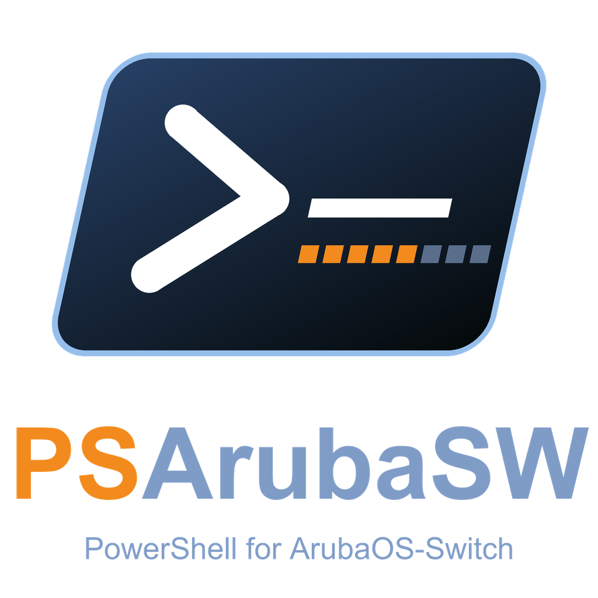
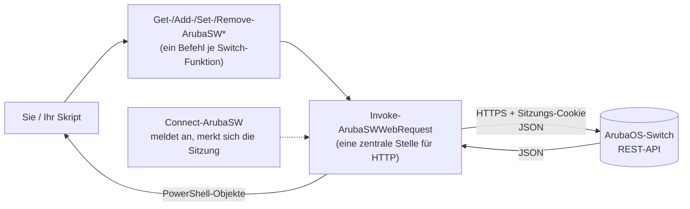

<p align="center">
  
</p>

<h1 align="center">PSArubaSW</h1>

<p align="center">
  <b>ArubaOS-Switches mit PowerShell verwalten</b> &ndash; VLANs, Ports, PoE, RADIUS, SNMP, 802.1X und mehr,
  mit einfachen Befehlen statt Klicken auf Webseiten oder Tippen in der Switch-Kommandozeile.
</p>

<p align="center">
  <a href="https://github.com/gitnol/PSArubaSW/actions/workflows/tests.yml"></a>
  
  
</p>

<p align="center">
  🇬🇧 <a href="README.md">English</a> &nbsp;|&nbsp; 🇩🇪 Deutsch
</p>

---

## Inhalt

1. [Was ist das?](#was-ist-das)
2. [Schnellstart (5 Minuten)](#schnellstart-5-minuten)
3. [Wie die Befehle aufgebaut sind](#wie-die-befehle-aufgebaut-sind)
4. [Durchgespieltes Beispiel: VLAN anlegen, prüfen, löschen](#durchgespieltes-beispiel-vlan-anlegen-prüfen-löschen)
5. [Was sich verwalten lässt](#was-sich-verwalten-lässt)
6. [Sicher arbeiten](#sicher-arbeiten)
7. [Anmelden ohne Passwort-Tippen](#anmelden-ohne-passwort-tippen)
8. [Mehrere Switches, andere API-Versionen](#mehrere-switches-andere-api-versionen)
9. [So funktioniert es innen](#so-funktioniert-es-innen)
10. [Fehlersuche](#fehlersuche)
11. [Kompatibilität und Prüfstand](#kompatibilität-und-prüfstand)
12. [Für Entwickler: Tests und Aufbau](#für-entwickler-tests-und-aufbau)
13. [Herkunft und Lizenz](#herkunft-und-lizenz)

---

## Was ist das?

Ein ArubaOS-Switch (HPE/Aruba 2530, 2540, 2930, 3810, 5400R und andere) hat eine eingebaute **REST-Schnittstelle**.
**PSArubaSW** ist ein PowerShell-Modul, das diese Schnittstelle für Sie anspricht.

Statt:

```text
switch# configure
switch(config)# vlan 85
switch(vlan-85)# name Gaeste
switch(vlan-85)# voice
```

schreiben Sie:

```powershell
Add-ArubaSWVlans -id 85 -Name 'Gaeste' -is_voice_enabled
```

und bekommen ein **PowerShell-Objekt** zurück, das Sie filtern, sortieren, nach CSV exportieren oder an den nächsten Befehl weitergeben können.

**Warum das lohnt:**

- 🔁 **Wiederholbar:** dasselbe Skript ergibt auf 1 oder auf 50 Switches dasselbe Ergebnis.
- 🔍 **Lesbar:** `Get-ArubaSWPort | Where-Object …` statt durch `show`-Ausgaben zu scrollen.
- 🛡️ **Sicherer:** Befehle, die Einstellungen ändern oder löschen (`Set-`, `Remove-`), unterstützen `-WhatIf` (Probelauf) und fragen bei Bedarf nach.
- 🧰 **Über 200 Befehle** für die häufigsten Switch-Einstellungen.

> [!NOTE]
> PSArubaSW ist eine Bibliothek, kein Dienst. Nichts läuft im Hintergrund, nichts wird auf der Festplatte gespeichert
> (außer Sie verlangen es) und jeder Befehl spricht live mit dem Switch.

---

## Schnellstart (5 Minuten)

### Was Sie brauchen

| Sie brauchen | Einzelheiten |
|---|---|
| **PowerShell 7 oder neuer** | Windows, Linux oder macOS. Prüfen mit `$PSVersionTable.PSVersion`. Windows PowerShell 5.1 wird von den automatischen Tests **nicht abgedeckt**. |
| **Einen ArubaOS-Switch** | Firmware 16.x. Beginnen Sie mit einem **Labor- oder Testswitch**, nicht mit dem produktiven Kern. |
| **Eingeschaltetes REST** | Einmalige Einrichtung am Switch, siehe unten. |
| **Ein Administratorkonto** | Benutzername und Kennwort des Switch-Administrators (Manager). |

### Schritt 1: REST-Schnittstelle am Switch einschalten (einmal pro Switch)

An der Switch-Kommandozeile anmelden und eingeben (die genauen Befehle können je nach Firmware leicht abweichen, siehe REST-Handbuch von Aruba zu Ihrer Version):

```text
configure
web-management ssl
rest-interface
write memory
```

### Schritt 2: Modul holen

```powershell
git clone https://github.com/gitnol/PSArubaSW.git
cd PSArubaSW
Import-Module ./PowerArubaSW/PowerArubaSW.psd1
```

> [!NOTE]
> Das Repository heißt **PSArubaSW**, das PowerShell-Modul darin heißt **PowerArubaSW**
> (der Name bleibt, damit vorhandene Skripte weiter laufen). Alle Befehle enthalten `ArubaSW`.
> Führen Sie nicht `Install-Module PowerArubaSW` aus: Das würde das Originalprojekt aus der PowerShell Gallery installieren, nicht diese Version.

Prüfen, ob es geladen ist:

```powershell
Get-Command -Module PowerArubaSW | Measure-Object     # rund 200 Befehle
Get-Help Get-ArubaSWVlans -Examples                  # eingebaute Hilfe zu jedem Befehl
```

### Schritt 3: verbinden und umsehen

```powershell
Connect-ArubaSW 192.0.2.1 -SkipCertificateCheck      # fragt nach Benutzername und Kennwort
```

`-SkipCertificateCheck` brauchen Sie, solange der Switch sein selbstsigniertes Zertifikat benutzt (bei neuen Switches üblich).
Nur in Netzen verwenden, denen Sie vertrauen.

```powershell
Get-ArubaSWSystem                 # Name, Standort, Kontakt
Get-ArubaSWSystemStatusSwitch     # Produktname, Firmware-Version, Seriennummer
Get-ArubaSWVlans                  # alle VLANs
Get-ArubaSWPort | Select-Object id, name, is_port_enabled, is_port_up | Format-Table
```

### Schritt 4: trennen

```powershell
Disconnect-ArubaSW
```

Mehr brauchen Sie für den Start nicht. Alles Weitere folgt demselben Muster.

---

## Wie die Befehle aufgebaut sind

Jeder Befehl heißt **`Verb-ArubaSW<Sache>`**. Wer die vier Verben kennt, kennt das ganze Modul:

| Verb | Was es tut | Ändert den Switch? | Beispiel |
|---|---|:-:|---|
| `Get` | lesen | nein | `Get-ArubaSWVlans` |
| `Add` | Neues anlegen | **ja** | `Add-ArubaSWVlans -id 85 -Name Gaeste` |
| `Set` | Vorhandenes ändern | **ja** | `Set-ArubaSWVlans -id 85 -Name Besucher` |
| `Remove` | löschen | **ja** | `Remove-ArubaSWVlans -id 85` |

Gut zu wissen:

- **Hilfe ist eingebaut:** `Get-Help <Befehl> -Full` zeigt jeden Parameter mit Beispielen.
- **Tab-Vervollständigung** funktioniert für Befehls- und Parameternamen.
- **Ergebnisse sind Objekte**, also funktioniert `Get-ArubaSWVlans | Where-Object name -like 'Gast*' | Format-Table` wie erwartet.
- Einige Sonderverben: `Connect`, `Disconnect`, `Save` (Zugangsdaten), `Send` (CLI-Batch), `Restart`, `Reset`, `Test` (Ping, Traceroute).

---

## Durchgespieltes Beispiel: VLAN anlegen, prüfen, löschen

Führen Sie das an einem **Testswitch** aus. Zeilen mit `#` sind Kommentare.

```powershell
# 1. Verbinden
Connect-ArubaSW 192.0.2.1 -SkipCertificateCheck

# 2. VLAN anlegen
Add-ArubaSWVlans -id 85 -Name 'Gaeste' -is_voice_enabled
```

Sie bekommen das neue VLAN zurück:

```text
uri               : /vlans/85
vlan_id           : 85
name              : Gaeste
status            : VS_PORT_BASED
type              : VT_STATIC
is_voice_enabled  : True
is_jumbo_enabled  : False
is_dsnoop_enabled : False
```

```powershell
# 3. Port 1/5 als untagged in das VLAN legen
Add-ArubaSWVlansPorts -vlan_id 85 -port_id 1/5 -port_mode POM_UNTAGGED

# 4. Prüfen
Get-ArubaSWVlans -Name Gaeste
Get-ArubaSWVlansPorts -vlan_id 85

# 5. Probelauf: zeigt, was passieren WÜRDE, ändert nichts
Set-ArubaSWVlans -id 85 -Name 'Besucher' -WhatIf

# 6. Aufräumen (fragt nach; mit -Confirm:$false in Skripten ohne Rückfrage)
Remove-ArubaSWVlansPorts -vlan_id 85 -port_id 1/5
Remove-ArubaSWVlans -id 85

Disconnect-ArubaSW
```

> [!TIP]
> Unsicher bei einem Parameter? `Get-Help Add-ArubaSWVlansPorts -Examples` zeigt funktionierende Aufrufe.

---

## Was sich verwalten lässt

Die Befehle folgen den Bereichen des Switches. Jeder Bereich hat die Verben, die dafür Sinn ergeben
(zum Beispiel `Get-` und `Set-` für Einstellungen, dazu `Add-` und `Remove-` für Listen).

| Bereich | Typische Befehlsnamen (hinter dem Verb) |
|---|---|
| **System** | `ArubaSWSystem`, `…SystemStatus`, `…SystemTime`, `…SystemEventLog`, `…Banner`, `…Led`, `…Modules`, `…IpAddress` |
| **VLANs** | `…Vlans`, `…VlansPorts`, `…VlanIpAddress` |
| **Ports und PoE** | `…Port`, `…PortStatistics`, `…PortMirror`, `…PoE`, `…PoEStats`, `…Jumbo`, `…Transceiver`, `…Smartrate` |
| **Link-Aggregation** | `…Trunk`, `…LACP` |
| **Spanning Tree** | `…STP`, `…STPPort`, `…Mstp`, `…MstpPort` |
| **Nachbarn** | `…LLDP*`, `…Cdp` |
| **Routing und DHCP** | `…IpRoute`, `…IpRouteSettings`, `…DhcpRelay`, `…DhcpRelayOption82`, `…DhcpRelayVlan` |
| **Namens- und Zeitdienste** | `…Dns`, `…Sntp`, `…SntpServer`, `…Syslog`, `…SyslogFilter`, `…SyslogEventCriteria` |
| **Zugriffskontrolle** | `…Authentication*`, `…Authorization`, `…Accounting`, `…RadiusServer`, `…RadiusServerGroup`, `…RadiusProfile`, `…ManagementUser` |
| **802.1X, MAC- und Web-Auth** | `…Dot1x*`, `…MacAuthentication*`, `…Webauth*` |
| **SNMP** | `…Snmp*`, `…Snmpv3*` |
| **Diagnose** | `Test-ArubaSWPing`, `Test-ArubaSWTraceRoute`, `…MacTable` |
| **Wartung** | `Restart-ArubaSWSystem`, `Reset-ArubaSWConfiguration`, `…Fastboot`, `…FileTransfer` |
| **Alles andere** | `Get-ArubaSWCli`, `Send-ArubaSWCliBatch` (rohe CLI, siehe [Warnung](#sicher-arbeiten)), `Invoke-ArubaSWWebRequest` (roher REST-Aufruf) |

<details>
<summary><b>Vollständige Befehlsliste anzeigen</b></summary>

```powershell
Get-Command -Module PowerArubaSW | Sort-Object Name | Select-Object -ExpandProperty Name
```

Oder nach Bereich filtern, zum Beispiel alles zu RADIUS:

```powershell
Get-Command -Module PowerArubaSW -Name *Radius*
```

</details>

> [!IMPORTANT]
> Der Switch entscheidet, was es gibt. Manche Modelle oder Firmware-Versionen bieten nicht jede Funktion an
> (zum Beispiel ist `Set-ArubaSWSystemTimeManually` auf der 2540 nicht verfügbar).
> Siehe [Kompatibilität](#kompatibilität-und-prüfstand).

---

## Sicher arbeiten

| Regel | Warum |
|---|---|
| **Zuerst an einem Laborswitch testen.** | Änderungen gehen direkt in die laufende Konfiguration des Switches. |
| **Zuerst `-WhatIf` benutzen.** | Alle `Set-`- und `Remove-`-Befehle (und die meisten `Add-`-Befehle) zeigen, was sie tun würden, ohne es zu tun. |
| **Rückfragen erwarten.** | Riskante Befehle (löschen, zurücksetzen, neu starten) fragen vorher nach. In Skripten `-Confirm:$false` nur nutzen, wenn Sie sicher sind. |
| **Speichern ist ein eigener Schritt.** | Änderungen liegen in der laufenden Konfiguration. Sie in die Startkonfiguration zu übernehmen ist ein eigener Schritt (zum Beispiel `write memory` in der CLI). |
| **HTTPS bevorzugen.** | `-httpOnly` sendet das Kennwort unverschlüsselt und verlangt `-Force` als bewusste Bestätigung. |
| **CLI-Befehle mit Vorsicht.** | `Get-ArubaSWCli` und `Send-ArubaSWCliBatch` reichen Text **unverändert** an den Switch weiter. Bauen Sie diese Texte nie aus nicht vertrauenswürdigen Eingaben (Webformulare, fremde Dateien). Bevorzugen Sie die eigenen Befehle wie `Set-ArubaSWPort`. |
| **Auf die Antworten achten.** | Manche Antworten enthalten Geheimnisse (zum Beispiel RADIUS-Schlüssel). Ausgaben nicht ungeprüft in Tickets oder Chats einfügen. |

---

## Anmelden ohne Passwort-Tippen

`Connect-ArubaSW` sucht die Zugangsdaten in dieser Reihenfolge. Nehmen Sie den ersten Weg, der passt:

| # | Weg | Beispiel | Geeignet für |
|---|---|---|---|
| 1 | Eingabeaufforderung | `Connect-ArubaSW 192.0.2.1` | manuelle Nutzung |
| 2 | `PSCredential` | `Connect-ArubaSW 192.0.2.1 -Credentials (Get-Credential)` | Skripte, die Sie selbst starten |
| 3 | Windows-Anmeldeinformationsverwaltung | einmal `Save-ArubaSWCredential -Server 192.0.2.1`, danach nur `Connect-ArubaSW 192.0.2.1` | Windows, geplante Aufgaben |
| 4 | SecretManagement-Tresor | `Connect-ArubaSW 192.0.2.1 -SecretName SwitchAdmin` | alle Plattformen, Teams |
| 5 | Benutzername und `SecureString` | `Connect-ArubaSW 192.0.2.1 -Username manager -Password $secure` | Automatisierung |

- Der Eintrag in der Anmeldeinformationsverwaltung wird von Windows verschlüsselt, gilt nur für Ihren Benutzer auf Ihrem Rechner, und das Kennwort
  steht nie in einer Kommandozeile. Entfernen mit `Remove-ArubaSWCredential`.
- SecretManagement (`Microsoft.PowerShell.SecretManagement`) ist **optional** und wird mit diesem Modul nicht installiert.
- Schreiben Sie nie Kennwörter in Skripte oder in Dateien, die in Git landen.

---

## Mehrere Switches, andere API-Versionen

### Mehrere Switches gleichzeitig

Standardmäßig speichert `Connect-ArubaSW` die Verbindung in einer Sitzungsvariablen, die alle Befehle benutzen.
Für mehrere Switches halten Sie jede Verbindung in einer eigenen Variablen und übergeben sie mit `-connection`:

```powershell
$sw1 = Connect-ArubaSW 192.0.2.1 -SkipCertificateCheck -DefaultConnection:$false
$sw2 = Connect-ArubaSW 192.0.2.2 -SkipCertificateCheck -DefaultConnection:$false

Get-ArubaSWVlansPorts -connection $sw1
Get-ArubaSWVlansPorts -connection $sw2

# Dieselbe Änderung auf beiden:
foreach ($sw in $sw1, $sw2) { Set-ArubaSWSystem -contact 'netzwerk@example.com' -connection $sw }
```

### REST-API-Version wählen

Switches bieten mehrere REST-Versionen an (v1 bis v8). Das Modul meldet sich mit v3 an und nutzt danach die höchste Version,
die der Switch kennt. Für sehr alte Geräte können Sie eine Version erzwingen:

```powershell
Connect-ArubaSW 192.0.2.1 -SkipCertificateCheck -api_version 2
```

---

## So funktioniert es innen



1. `Connect-ArubaSW` meldet an (`POST /rest/v3/login-sessions`), erhält ein **Sitzungs-Cookie** und merkt es sich in der Sitzung.
2. Jeder Befehl baut einen REST-Aufruf, schickt ihn über **eine zentrale Funktion** und macht aus der JSON-Antwort ein PowerShell-Objekt.
3. `Disconnect-ArubaSW` beendet die Sitzung am Switch.

Gut zu wissen: Es gibt keine Datenbank und keinen Zwischenspeicher. Jede Antwort kommt live vom Switch.
Dieses Modul unterstützt **nur ArubaOS-Switch** (nicht Aruba CX, nicht Controller oder Access Points).

---

## Fehlersuche

| Meldung oder Symptom | Was es meist bedeutet | Was zu tun ist |
|---|---|---|
| `Unable to Connect (certificate)` | Der Switch nutzt ein selbstsigniertes oder abgelaufenes Zertifikat. | Mit `-SkipCertificateCheck` verbinden oder ein richtiges Zertifikat auf dem Switch installieren. |
| `Unable to Connect` | HTTPS oder REST ist nicht eingeschaltet, falsche IP, Firewall. | Am Switch `show web-management` ausführen: HTTPS muss *Enabled* sein. Dann `web-management ssl` und `rest-interface` einschalten (siehe [Schritt 1](#schritt-1-rest-schnittstelle-am-switch-einschalten-einmal-pro-switch)). Prüfen, ob TCP 443 erreichbar ist. |
| Anmeldung scheitert, obwohl das Kennwort stimmt | Zu viele offene REST-Sitzungen (der Switch erlaubt nur wenige) oder ein Operator-Konto. | Nach der Arbeit `Disconnect-ArubaSW` ausführen. Für Änderungen ein Manager-Konto nehmen (Operatoren dürfen nur lesen). |
| Ein Befehl antwortet mit 404 oder „not supported" | Ihr Modell oder Ihre Firmware hat die Funktion nicht. | Modell mit `Get-ArubaSWSystemStatusSwitch` prüfen und die [Kompatibilitätshinweise](#kompatibilität-und-prüfstand) lesen. |
| `Connect-ArubaSW … -httpOnly` weigert sich | Reines HTTP sendet das Kennwort unverschlüsselt. | HTTPS bevorzugen. Wenn es wirklich sein muss: `-Force` ergänzen. |
| Mehr Details nötig | | `-Verbose` an einen beliebigen Befehl anhängen. |

---

## Kompatibilität und Prüfstand

- **Läuft auf:** PowerShell 7 oder neuer unter Windows, Linux und macOS. Die automatischen Tests laufen unter Windows und Ubuntu mit PowerShell 7.
  Windows PowerShell 5.1 ist von den automatischen Tests nicht abgedeckt; behandeln Sie es als ungetestet.
- **Switches:** ArubaOS-Switch, Firmware 16.x. Das Originalprojekt berichtete vom Einsatz mit den Familien 2530, 2930F, 2930M, 3810 und 54xxR.
- **In dieser Version gründlich geprüft:** die Familie **2540** (zum Beispiel Firmware YC.16.11). Befehl für Befehl wurden Änderungen geschrieben,
  zurückgelesen und wiederhergestellt.
- **Nicht geprüft:** Andere Familien kennen unter Umständen andere Feldnamen oder haben manche Funktionen nicht. Ergebnisse dort mit Vorsicht behandeln und zuerst testen.
- **Bekannte Lücken:** Einige Befehle funktionieren auf der 2540 nachweislich nicht, zum Beispiel `Set-ArubaSWSystemTimeManually`,
  `Get-ArubaSWModules`, `Get-ArubaSWConfigStatus` und das globale `Set-ArubaSWMstp`.
  `Get-ArubaSWIncludeCredentials`/`Set-ArubaSWIncludeCredentials` können Zugangsdaten in die Startkonfiguration schreiben; nur mit Absicht verwenden.
- Die REST-API des Switches ist nicht vollständig: Nicht jede Switch-Funktion hat einen REST-Endpunkt. Für den Rest dienen die CLI-Befehle (mit Vorsicht).

Etwas verhält sich auf Ihrer Hardware anders? Bitte ein Issue öffnen und Modell und Firmware nennen.

---

## Für Entwickler: Tests und Aufbau

### Unit-Tests ausführen (kein Switch nötig)

```powershell
Install-Module Pester -RequiredVersion 5.7.1 -Scope CurrentUser -Force -SkipPublisherCheck
$cfg = & ./Tests/pester.config.ps1 -Tag Unit
Invoke-Pester -Configuration $cfg
```

Die festgelegte Pester-Version steht in `Tests/RequiredModules.psd1`. Die Unit-Tests ersetzen den Webaufruf durch eine aufgezeichnete Antwort,
sind also schnell und berühren keinen Switch. **Integrationstests** (`Tests/integration`) sprechen mit einem echten Switch und ändern dessen Konfiguration:
nur an einem **Testswitch** verwenden, siehe `Tests/README.md`.

### Ordneraufbau

```text
PowerArubaSW/            das Modul
  PowerArubaSW.psd1      Manifest (Version, exportierte Befehle)
  PowerArubaSW.psm1      Lader
  Public/                eine Datei je Switch-Bereich (Vlans.ps1, Port.ps1, Snmp.ps1, ...)
  Private/               Hilfsfunktionen: Webaufruf, Anmelde-Cookie, TLS, Fehlerausgabe, Zugangsdaten-Speicher
Tests/
  unit/                  schnelle Tests ohne Switch
  integration/           Tests gegen einen echten (Test-)Switch
  fixtures/              aufgezeichnete Switch-Antworten für die Unit-Tests
Tools/                   Hilfsskripte (Fixtures aufzeichnen, Mutationsprüfung, Nur-Lese-Durchlauf)
```

### Einen Befehl ergänzen (Kurzfassung)

1. Das Muster einer ähnlichen Datei in `PowerArubaSW/Public/` übernehmen (Verb, Parameter, Hilfe im Kommentar, `-connection`).
2. Den Funktionsnamen in `FunctionsToExport` im Manifest eintragen.
3. In `Tests/unit/` einen Unit-Test ergänzen, der den REST-Aufruf prüft (Methode, URI, Body).
4. Unit-Tests und PSScriptAnalyzer ausführen.

---

## Herkunft und Lizenz

PowerArubaSW wurde von **Alexis La Goutte** und der PowerAruba-Community geschaffen:
<https://github.com/PowerAruba/PowerArubaSW>.
PSArubaSW ist eine eigenständige, stark erweiterte Fortsetzung dieses Projekts (viele neue Befehle, überarbeitete Anmeldung und
Zugangsdaten-Behandlung sowie eine deutlich größere Testsuite). Der ursprüngliche Urheberrechtshinweis bleibt in der Datei `LICENSE` und im Modul-Manifest erhalten.
Die Historie dieses Repositorys beginnt mit dieser Version.

Maintainer dieser Fortsetzung: [gitnol](https://github.com/gitnol)

Besonderer Dank aus dem Originalprojekt: Warren F. für seinen Blogbeitrag
[Building a PowerShell module](http://ramblingcookiemonster.github.io/Building-A-PowerShell-Module/) und Erwan Quelin für Hilfe bei PowerShell.

Lizenz: **Apache License 2.0**, siehe [LICENSE](LICENSE).
Copyright 2018-2021 Alexis La Goutte und die Community. Copyright 2026 gitnol (Änderungen und Ergänzungen dieser Fortsetzung).

*Aruba und ArubaOS sind Marken der Hewlett Packard Enterprise. Dieses Projekt ist unabhängig und steht in keiner Verbindung zu HPE und wird von HPE nicht unterstützt.*
