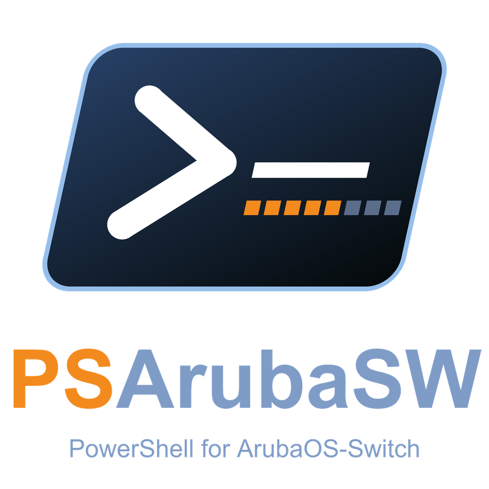
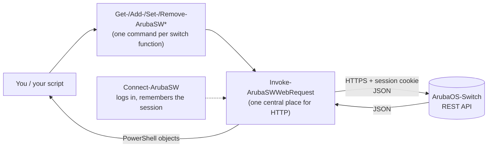

<p align="center">
  
</p>

<h1 align="center">PSArubaSW</h1>

<p align="center">
  <b>Manage ArubaOS-Switches from PowerShell</b> &ndash; VLANs, ports, PoE, RADIUS, SNMP, 802.1X and more,
  with plain commands instead of clicking through web pages or typing CLI by hand.
</p>

<p align="center">
  <a href="https://github.com/gitnol/PSArubaSW/actions/workflows/tests.yml"></a>
  
  
</p>

<p align="center">
  🇬🇧 English &nbsp;|&nbsp; 🇩🇪 <a href="README.de.md">Deutsch</a>
</p>

---

## Contents

1. [What is this?](#what-is-this)
2. [Quick start (5 minutes)](#quick-start-5-minutes)
3. [How the commands are built](#how-the-commands-are-built)
4. [Worked example: create, check, remove a VLAN](#worked-example-create-check-remove-a-vlan)
5. [What you can manage](#what-you-can-manage)
6. [Working safely](#working-safely)
7. [Logging in without typing passwords](#logging-in-without-typing-passwords)
8. [More than one switch, other API versions](#more-than-one-switch-other-api-versions)
9. [How it works inside](#how-it-works-inside)
10. [Troubleshooting](#troubleshooting)
11. [Compatibility and what is verified](#compatibility-and-what-is-verified)
12. [For developers: tests and layout](#for-developers-tests-and-layout)
13. [Credits and license](#credits-and-license)

---

## What is this?

An ArubaOS-Switch (HPE/Aruba 2530, 2540, 2930, 3810, 5400R and others) has a built-in **REST interface**.
**PSArubaSW** is a PowerShell module that talks to it for you.

Instead of this:

```text
switch# configure
switch(config)# vlan 85
switch(vlan-85)# name Guests
switch(vlan-85)# voice
```

you write this:

```powershell
Add-ArubaSWVlans -id 85 -Name 'Guests' -is_voice_enabled
```

and you get a **PowerShell object** back that you can filter, sort, export to CSV or feed into the next command.

**Why bother?**

- 🔁 **Repeatable:** the same script gives the same result on 1 or on 50 switches.
- 🔍 **Readable:** `Get-ArubaSWPort | Where-Object …` instead of scrolling through `show` output.
- 🛡️ **Safer:** the commands that change or delete settings (`Set-`, `Remove-`) support `-WhatIf` (a dry run) and ask for confirmation when it matters.
- 🧰 **Over 200 commands** for the most common switch settings.

> [!NOTE]
> PSArubaSW is a client library, not a service. Nothing runs in the background, nothing is stored on disk
> (unless you ask for it) and every command talks to the switch live.

---

## Quick start (5 minutes)

### What you need

| You need | Details |
|---|---|
| **PowerShell 7 or newer** | Windows, Linux or macOS. Check with `$PSVersionTable.PSVersion`. Windows PowerShell 5.1 is **not covered** by the automated tests. |
| **An ArubaOS-Switch** | Firmware 16.x. Start with a **lab or test switch**, not your production core. |
| **REST switched on** | One-time setup on the switch, see below. |
| **A manager account** | User name and password of the switch administrator. |

### Step 1: switch on the REST interface (once per switch)

Log in to the switch CLI and enter (exact commands can differ slightly by firmware, see the Aruba REST guide for your version):

```text
configure
web-management ssl
rest-interface
write memory
```

### Step 2: get the module

```powershell
git clone https://github.com/gitnol/PSArubaSW.git
cd PSArubaSW
Import-Module ./PowerArubaSW/PowerArubaSW.psd1
```

> [!NOTE]
> The repository is called **PSArubaSW**, the PowerShell module inside is called **PowerArubaSW**
> (the name is kept so that existing scripts keep working). The command names all contain `ArubaSW`.
> Do not run `Install-Module PowerArubaSW`: that would install the original project from the PowerShell Gallery, not this version.

Check that it loaded:

```powershell
Get-Command -Module PowerArubaSW | Measure-Object     # about 200 commands
Get-Help Get-ArubaSWVlans -Examples                  # built-in help for every command
```

### Step 3: connect and look around

```powershell
Connect-ArubaSW 192.0.2.1 -SkipCertificateCheck      # asks for user name and password
```

`-SkipCertificateCheck` is needed while the switch still uses its self-signed certificate (typical for new switches).
Use it only on networks you trust.

```powershell
Get-ArubaSWSystem                 # name, location, contact
Get-ArubaSWSystemStatusSwitch     # product name, firmware version, serial number
Get-ArubaSWVlans                  # all VLANs
Get-ArubaSWPort | Select-Object id, name, is_port_enabled, is_port_up | Format-Table
```

### Step 4: disconnect

```powershell
Disconnect-ArubaSW
```

That is all you need to start. Everything else builds on the same pattern.

---

## How the commands are built

Every command is **`Verb-ArubaSW<Thing>`**. Learn the four verbs and you know the whole module:

| Verb | What it does | Changes the switch? | Example |
|---|---|:-:|---|
| `Get` | read | no | `Get-ArubaSWVlans` |
| `Add` | create something new | **yes** | `Add-ArubaSWVlans -id 85 -Name Guests` |
| `Set` | change something that exists | **yes** | `Set-ArubaSWVlans -id 85 -Name Visitors` |
| `Remove` | delete | **yes** | `Remove-ArubaSWVlans -id 85` |

Things to know:

- **Help is built in:** `Get-Help <command> -Full` shows every parameter with examples.
- **Tab completion** works for command and parameter names.
- **Results are objects**, so `Get-ArubaSWVlans | Where-Object name -like 'Guest*' | Format-Table` works as you would expect.
- A few special verbs exist: `Connect`, `Disconnect`, `Save` (credentials), `Send` (CLI batch), `Restart`, `Reset`, `Test` (ping, traceroute).

---

## Worked example: create, check, remove a VLAN

Run this on a **test switch**. Lines starting with `#` are comments.

```powershell
# 1. Connect
Connect-ArubaSW 192.0.2.1 -SkipCertificateCheck

# 2. Create the VLAN
Add-ArubaSWVlans -id 85 -Name 'Guests' -is_voice_enabled
```

You get the new VLAN back:

```text
uri               : /vlans/85
vlan_id           : 85
name              : Guests
status            : VS_PORT_BASED
type              : VT_STATIC
is_voice_enabled  : True
is_jumbo_enabled  : False
is_dsnoop_enabled : False
```

```powershell
# 3. Put port 1/5 into the VLAN as untagged
Add-ArubaSWVlansPorts -vlan_id 85 -port_id 1/5 -port_mode POM_UNTAGGED

# 4. Check
Get-ArubaSWVlans -Name Guests
Get-ArubaSWVlansPorts -vlan_id 85

# 5. Dry run: show what WOULD happen, change nothing
Set-ArubaSWVlans -id 85 -Name 'Visitors' -WhatIf

# 6. Clean up (asks for confirmation; add -Confirm:$false to skip the question in scripts)
Remove-ArubaSWVlansPorts -vlan_id 85 -port_id 1/5
Remove-ArubaSWVlans -id 85

Disconnect-ArubaSW
```

> [!TIP]
> Not sure about a parameter? `Get-Help Add-ArubaSWVlansPorts -Examples` shows working calls.

---

## What you can manage

The commands follow the areas of the switch. Each area has the verbs that make sense for it
(for example `Get-` and `Set-` for settings, plus `Add-` and `Remove-` for lists).

| Area | Typical command names (after the verb) |
|---|---|
| **System** | `ArubaSWSystem`, `…SystemStatus`, `…SystemTime`, `…SystemEventLog`, `…Banner`, `…Led`, `…Modules`, `…IpAddress` |
| **VLANs** | `…Vlans`, `…VlansPorts`, `…VlanIpAddress` |
| **Ports and PoE** | `…Port`, `…PortStatistics`, `…PortMirror`, `…PoE`, `…PoEStats`, `…Jumbo`, `…Transceiver`, `…Smartrate` |
| **Link aggregation** | `…Trunk`, `…LACP` |
| **Spanning tree** | `…STP`, `…STPPort`, `…Mstp`, `…MstpPort` |
| **Neighbors** | `…LLDP*`, `…Cdp` |
| **Routing and DHCP** | `…IpRoute`, `…IpRouteSettings`, `…DhcpRelay`, `…DhcpRelayOption82`, `…DhcpRelayVlan` |
| **Name and time services** | `…Dns`, `…Sntp`, `…SntpServer`, `…Syslog`, `…SyslogFilter`, `…SyslogEventCriteria` |
| **Access control** | `…Authentication*`, `…Authorization`, `…Accounting`, `…RadiusServer`, `…RadiusServerGroup`, `…RadiusProfile`, `…ManagementUser` |
| **802.1X, MAC and web auth** | `…Dot1x*`, `…MacAuthentication*`, `…Webauth*` |
| **SNMP** | `…Snmp*`, `…Snmpv3*` |
| **Diagnostics** | `Test-ArubaSWPing`, `Test-ArubaSWTraceRoute`, `…MacTable` |
| **Maintenance** | `Restart-ArubaSWSystem`, `Reset-ArubaSWConfiguration`, `…Fastboot`, `…FileTransfer` |
| **Anything else** | `Get-ArubaSWCli`, `Send-ArubaSWCliBatch` (raw CLI, see [warning](#working-safely)), `Invoke-ArubaSWWebRequest` (raw REST call) |

<details>
<summary><b>Show the complete list of commands</b></summary>

```powershell
Get-Command -Module PowerArubaSW | Sort-Object Name | Select-Object -ExpandProperty Name
```

Or filter by area, for example everything about RADIUS:

```powershell
Get-Command -Module PowerArubaSW -Name *Radius*
```

</details>

> [!IMPORTANT]
> The switch decides what exists. Some switch models or firmware versions do not offer every function
> (for example `Set-ArubaSWSystemTimeManually` is not available on the 2540).
> See [Compatibility](#compatibility-and-what-is-verified).

---

## Working safely

| Rule | Why |
|---|---|
| **Test on a lab switch first.** | Changes go straight into the running configuration of the switch. |
| **Use `-WhatIf` first.** | All `Set-` and `Remove-` commands (and most `Add-` commands) can show what they would do without doing it. |
| **Expect confirmation prompts.** | Risky commands (delete, reset, reboot) ask before they act. Use `-Confirm:$false` in scripts only when you are sure. |
| **Saving is separate.** | Changes live in the running configuration. Persisting them to the startup configuration is a separate step (for example `write memory` on the CLI). |
| **Prefer HTTPS.** | `-httpOnly` sends the password unencrypted and needs `-Force` as a deliberate confirmation. |
| **Treat the CLI commands with care.** | `Get-ArubaSWCli` and `Send-ArubaSWCliBatch` pass text to the switch **unchanged**. Never build those strings from untrusted input (web forms, files from others). Prefer the dedicated commands such as `Set-ArubaSWPort`. |
| **Mind what comes back.** | Some answers contain secrets (for example RADIUS shared secrets). Do not paste output into tickets or chats without checking it. |

---

## Logging in without typing passwords

`Connect-ArubaSW` looks for credentials in this order. Use the first one that fits:

| # | Way | Example | Good for |
|---|---|---|---|
| 1 | Interactive prompt | `Connect-ArubaSW 192.0.2.1` | manual use |
| 2 | `PSCredential` | `Connect-ArubaSW 192.0.2.1 -Credentials (Get-Credential)` | scripts you start yourself |
| 3 | Windows Credential Manager | `Save-ArubaSWCredential -Server 192.0.2.1` once, then just `Connect-ArubaSW 192.0.2.1` | Windows, scheduled tasks |
| 4 | SecretManagement vault | `Connect-ArubaSW 192.0.2.1 -SecretName SwitchAdmin` | all platforms, teams |
| 5 | User name and `SecureString` | `Connect-ArubaSW 192.0.2.1 -Username manager -Password $secure` | automation |

- The Credential Manager entry is encrypted by Windows, valid only for your user on your computer, and the password never
  appears on a command line. Remove it with `Remove-ArubaSWCredential`.
- SecretManagement (`Microsoft.PowerShell.SecretManagement`) is **optional**. It is not installed with this module.
- Never write passwords into scripts or into files that go into git.

---

## More than one switch, other API versions

### Several switches at the same time

By default `Connect-ArubaSW` stores the connection in a session variable that all commands use.
To work with several switches, keep each connection in its own variable and pass it with `-connection`:

```powershell
$sw1 = Connect-ArubaSW 192.0.2.1  -SkipCertificateCheck -DefaultConnection:$false
$sw2 = Connect-ArubaSW 192.0.2.2  -SkipCertificateCheck -DefaultConnection:$false

Get-ArubaSWVlansPorts -connection $sw1
Get-ArubaSWVlansPorts -connection $sw2

# The same change on both:
foreach ($sw in $sw1, $sw2) { Set-ArubaSWSystem -contact 'netops@example.com' -connection $sw }
```

### Choosing the REST API version

Switches offer several REST versions (v1 to v8). The module logs in with v3 and then uses the highest version
the switch supports. For very old devices you can force a version:

```powershell
Connect-ArubaSW 192.0.2.1 -SkipCertificateCheck -api_version 2
```

---

## How it works inside



1. `Connect-ArubaSW` logs in (`POST /rest/v3/login-sessions`), receives a **session cookie** and remembers it in the session.
2. Every command builds a REST call, sends it through **one central function** and turns the JSON answer into a PowerShell object.
3. `Disconnect-ArubaSW` ends the session on the switch.

Good to know: there is no database and no cache. Every answer is live from the switch.
This module supports **ArubaOS-Switch only** (not Aruba CX, not controllers or access points).

---

## Troubleshooting

| Message or symptom | What it usually means | What to do |
|---|---|---|
| `Unable to Connect (certificate)` | The switch uses a self-signed or expired certificate. | Connect with `-SkipCertificateCheck`, or install a proper certificate on the switch. |
| `Unable to Connect` | HTTPS or REST is not enabled, wrong IP, firewall. | On the switch run `show web-management`: HTTPS must be *Enabled*. Then enable `web-management ssl` and `rest-interface` (see [Step 1](#step-1-switch-on-the-rest-interface-once-per-switch)). Check that TCP 443 is reachable. |
| Login fails although the password is right | Too many open REST sessions (the switch allows only a few) or an operator account. | Run `Disconnect-ArubaSW` when done. Use a manager account for changes (operators can only read). |
| A command answers 404 or "not supported" | Your model or firmware does not have that function. | Check the model with `Get-ArubaSWSystemStatusSwitch`, read the [compatibility notes](#compatibility-and-what-is-verified). |
| `Connect-ArubaSW … -httpOnly` refuses to run | Plain HTTP sends the password unencrypted. | Prefer HTTPS. If you really must: add `-Force`. |
| Need more detail | | Add `-Verbose` to any command. |

---

## Compatibility and what is verified

- **Runs on:** PowerShell 7 or newer on Windows, Linux and macOS. The automated tests run on Windows and Ubuntu with PowerShell 7.
  Windows PowerShell 5.1 is not covered by the automated tests; treat it as untested.
- **Switches:** ArubaOS-Switch, firmware 16.x. The original project reported use with the 2530, 2930F, 2930M, 3810 and 54xxR families.
- **Verified in depth in this version:** the **2540** family (for example firmware YC.16.11). Command by command, changes were written,
  read back and restored.
- **Not verified:** other families may use different field names or lack some functions. Treat results there with care and test first.
- **Known gaps:** a few commands are known not to work on the 2540, for example `Set-ArubaSWSystemTimeManually`,
  `Get-ArubaSWModules`, `Get-ArubaSWConfigStatus` and the global `Set-ArubaSWMstp`.
  `Get-ArubaSWIncludeCredentials`/`Set-ArubaSWIncludeCredentials` can write credentials into the startup configuration; use them only on purpose.
- The REST API of the switch is not complete: not every switch function has a REST endpoint. For the rest, use the CLI commands (with care).

Found something that behaves differently on your hardware? Please open an issue and tell us the model and firmware.

---

## For developers: tests and layout

### Run the unit tests (no switch needed)

```powershell
Install-Module Pester -RequiredVersion 5.7.1 -Scope CurrentUser -Force -SkipPublisherCheck
$cfg = & ./Tests/pester.config.ps1 -Tag Unit
Invoke-Pester -Configuration $cfg
```

The pinned Pester version is in `Tests/RequiredModules.psd1`. The unit tests replace the web call with a recorded answer,
so they are fast and touch no switch. **Integration tests** (`Tests/integration`) talk to a real switch and change its configuration:
use them **only on a test switch**, see `Tests/README.md`.

### Folder layout

```text
PowerArubaSW/            the module
  PowerArubaSW.psd1      manifest (version, exported commands)
  PowerArubaSW.psm1      loader
  Public/                one file per switch area (Vlans.ps1, Port.ps1, Snmp.ps1, ...)
  Private/               helpers: web request, login cookie, TLS, error output, credential store
Tests/
  unit/                  fast tests without a switch
  integration/           tests against a real (test) switch
  fixtures/              recorded switch answers used by the unit tests
Tools/                   helper scripts (record fixtures, mutation check, read-only sweep)
```

### Adding a command (short version)

1. Copy the pattern of a similar file in `PowerArubaSW/Public/` (verb, parameters, comment-based help, `-connection`).
2. Add the function name to `FunctionsToExport` in the manifest.
3. Add a unit test in `Tests/unit/` that checks the REST call (method, URI, body).
4. Run the unit tests and PSScriptAnalyzer.

---

## Credits and license

PowerArubaSW was created by **Alexis La Goutte** and the PowerAruba community:
<https://github.com/PowerAruba/PowerArubaSW>.
PSArubaSW is an independent, heavily extended continuation of that project (many new commands, reworked connection and
credential handling, and a much larger test suite). The original copyright notice is kept in the `LICENSE` file and the module manifest.
The history of this repository starts with this version.

Maintainer of this continuation: [gitnol](https://github.com/gitnol)

Special thanks from the original project: Warren F. for his blog post
[Building a PowerShell module](http://ramblingcookiemonster.github.io/Building-A-PowerShell-Module/) and Erwan Quelin for help with PowerShell.

Licensed under the **Apache License 2.0**, see [LICENSE](LICENSE).
Copyright 2018-2021 Alexis La Goutte and the community. Copyright 2026 gitnol (changes and additions of this continuation).

*Aruba and ArubaOS are trademarks of Hewlett Packard Enterprise. This project is independent and not affiliated with or endorsed by HPE.*
